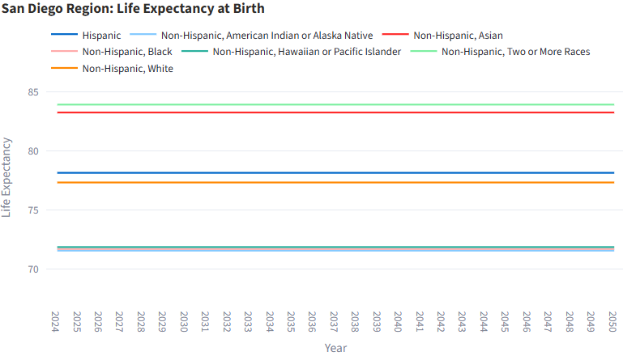
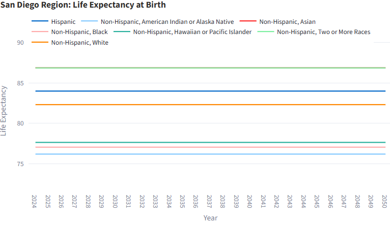
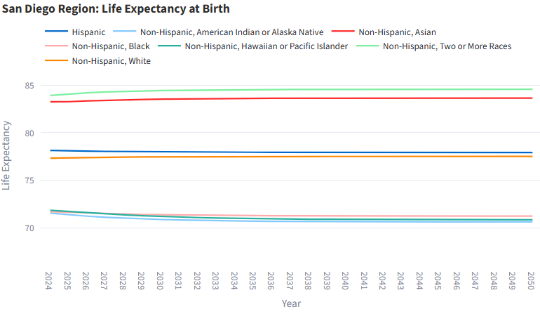
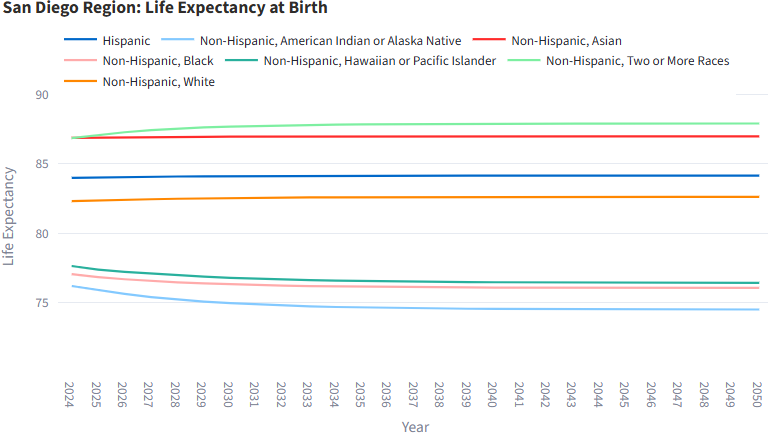
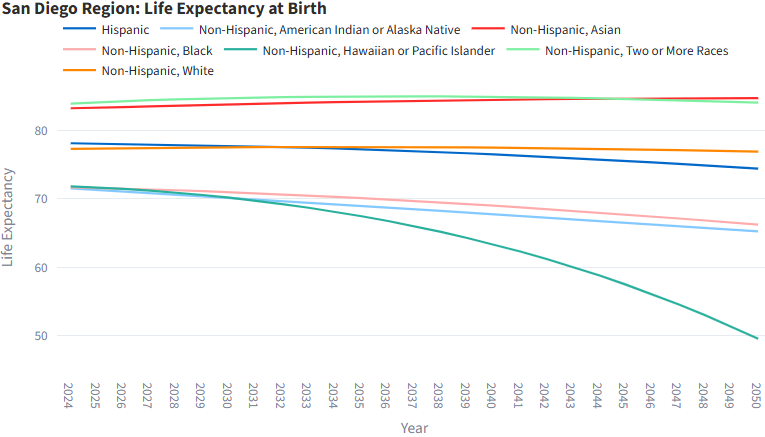
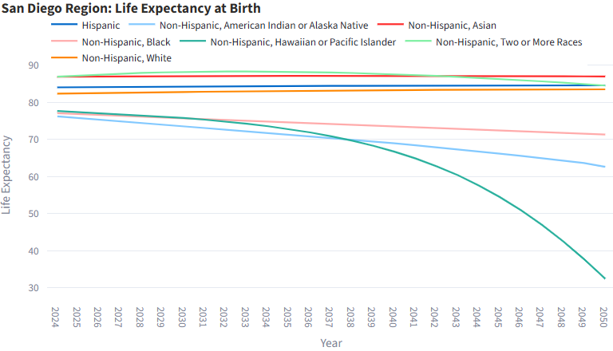

```{python}
import pandas as pd

import report.series16.series16 as series16

training_years = [2022, 2023, 2024]
increments = list(range(2025, 2051))

scenarios = {
    "moderate": series16.generate_mortality_forecast(
        training_years=training_years,
        increments=increments,
        phi=0.8,
        output_path="output/mortality_forecast_moderate.csv",
    ),
    "high": series16.generate_mortality_forecast(
        training_years=training_years,
        increments=increments,
        phi=0.98,
        output_path="output/mortality_forecast_high.csv",
    ),
}
```

Mortality rates are a vital input to the Cohort Component Model, which is used to project the region's population and households and inform the development of the Regional Forecast and Sustainable Communities Strategy. This report documents the process and rationale used to build historical mortality rate series for San Diego County and to forecast life expectancies derived from those rates. These forecasts are pivotal for accurately projecting the population and household dynamics of San Diego County, which in turn informs regional planning and policy decisions.

Mortality rates are forecast under three scenarios, described further in @sec-forecast-scenarios.

1.  **Constant** scenario: Assumes mortality rates remain fixed at their last observed value (2024) throughout the forecast period, serving as a baseline against which the other scenarios can be compared.
2.  **Moderate** scenario: Continues the observed historical mortality trend using our custom Lee-Carter model with moderate damping (`phi = 0.8`) applied, moderating the trend and preventing large deviations from recent years.
3.  **High** scenario: Continues the observed historical mortality trend using our custom Lee-Carter model with minimal damping (`phi = 0.98`) applied, allowing the historical trend to carry forward with little attenuation and producing larger deviations from recent years.

## Historical Mortality Rates

We build the historical time series for forecasting using the functions defined in `python/input_modules/death_rates.py`. Code has been provided in `report/series16/series16.py` to facilitate the construction of historical mortality rates.

Mortality rates draw on the CDC WONDER mortality database for ages 0 to 84, now paired with the UN DESA Life Table Survivors dataset for ages 85 and older. For both data sources, mortality rates are calculated as five-year averages, meaning the reported mortality rate for a given year represents the average rate over that year and the four preceding years. See [wiki/Death-Rates.md](Death-Rates.md) for the full data source descriptions, the county/state/national substitution hierarchy, population supplementation, and the UN DESA scaling methodology used to reconcile the two datasets for ages 85 and older.

For the historical timeline, we utilize all data from 2022 to 2024. We considered using data from 2010 to 2024 as well, but found that the changes in race and ethnicity classifications after 2020 would introduce inconsistencies for certain groups. After 2020, the CDC WONDER Mortality database expanded its race and ethnicity classifications from five categories (White; Black; Asian/Pacific Islander; American Indian/Alaska Native; and Hispanic) to seven categories (White; Black; Asian; Native Hawaiian or Other Pacific Islander; American Indian or Alaska Native; Hispanic; and Two or More Races). Because Two or More Races and Native Hawaiian or Pacific Islander do not exist as separate categories prior to 2022, extending the series back in time would require proxying these two categories using the product's all-races, non-Hispanic mortality data and giving both identical rates that reflect the overall non-Hispanic population rather than group-specific mortality. We also considered using 2010 to 2020, but found that this period is not representative of the true mortality rates for Native Hawaiian or Pacific Islander and Two or More Races. As a result, we focus on the 2022-2024 period, which lets us use true group-specific rates for all seven race and ethnicity classifications without proxying.

## Methodology for Forecasting Mortality Rates

With historical mortality rates for 2022 to 2024 in hand, we forecast future mortality rates under the three scenarios introduced above: a constant-rate baseline and two damped Lee-Carter model variants. Each methodology is described in further detail in the following sub-sections.

### Constant-Rate Baseline

One simple approach to forecasting is to hold rates constant, using the last year of data available (2024) and applying those rates to future years. Although constant rates provide a useful baseline for forecasting, they fail to account for historical mortality trends and demographic changes that may influence future mortality patterns. As constant rates assume mortality will never change, the resulting forecasts could overstate or understate future deaths and, consequently, the future population.

### Damped Lee-Carter Model

To account for this, we forecast mortality rates using a **Lee-Carter Model**, one of the most widely used statistical frameworks for forecasting mortality rates given its forecasting success and robustness and a cornerstone of demographic and actuarial analysis. Per the findings in our paper "Evaluating Mortality Forecasting Models in San Diego County" [report\series16\mortality_brief_report](Manuscript.docx), we find that a damped Lee-Carter model provides a more accurate representation of recent trends for mortality. A damping factor is applied such that the trends in mortality rates are exponentially decayed through the forecast horizon. Damping was chosen given the background research and conclusion that it produced higher accuracy under shorter fitting period conditions with long forecast horizons, avoiding naïvely carrying short-term observed trends decades into the future. As such, we use a "damped" version of the Lee-Carter model that gradually weakens the trend over the forecast period, so recent changes aren't assumed to continue at the same pace forever. We refer to this version as our custom Lee-Carter model. Our custom implementation can be found in [report/series16/series16.py](series16.py).

The Lee-Carter time index $\kappa_t$ is projected forward using a damped trend:

$$ \kappa_{T+n} = \kappa_{T} + \text{drift} \sum_{i=1}^{n} \phi^{i} \tag{1} $$

Where:

-   $\kappa_{T+n}$ is the projected time index $n$ years beyond the last observed year $T$
-   $\kappa_{T}$ is the time index value in the last observed year
-   $\text{drift}$ is the estimated average year-over-year change in $\kappa_t$ over the historical period
-   $\phi$ is the damping parameter controlling the strength of the damping effect
-   $n$ is the number of years into the forecast

Values of the damping parameter $\phi$ closer to 1 indicate less damping and greater adherence to the historical trend over time, while values closer to 0 indicate stronger damping and more conservative projections that approach the constant-rate baseline. See [Hyndman and Athanasopoulos (2018)](https://otexts.com/fpp3/exponential-smoothing.html#damped-trend-methods) for further background on damped trend methods.

Per the findings in our paper "Evaluating Mortality Forecasting Models in San Diego County" [report\series16\mortality_brief_report](Manuscript.docx), a damping value of 0.8 performs the best for capturing recent trends in mortality while avoiding overfitting in conjunction with our custom Lee-Carter model. In addition to our constant model forecast which serves as the baseline and our 0.8 damped Lee-Carter model (`moderate` scenario) which serves as the primary forecast, we also evaluated a 0.98 damped Lee-Carter model (`high` scenario) to emulate a scenario in which the historical trend is carried forward with little to no damping.

The resulting forecasts contain predicted mortality rates for each age, sex, and race/ethnicity group for the years 2025 through 2050 and can be used in the `config.yml` file to assert rates for forecasting years.

## Forecast Scenarios {#sec-forecast-scenarios}

With the forecasted mortality rates, we can compute the expected life expectancy at birth for each sex and race/ethnicity group. The forecasted life expectancy at birth for each sex and race/ethnicity from 2025 to 2050 is presented below for each of the three forecast scenarios. These values, aside from the constant model, are derived from the custom Lee-Carter model and reflect the expected trends based on historical data.

### Constant

The Constant scenario holds mortality rates fixed at their 2024 value throughout the forecast period, producing a flat baseline life expectancy trajectory for each sex and race/ethnicity group.

**Forecasted Male Life Expectancies**



**Forecasted Female Life Expectancies**



As we can see, the Constant scenario produces higher life expectancies for females than males, in line with general demographic patterns observed globally. In the male scenario, Two or More Races has the highest life expectancies, followed by Asian, Hispanic, White, Native Hawaiian or Pacific Islander, Black, and lastly American Indian or Alaska Native. Similarly, in the female scenario, Asian narrowly had the highest life expectancy followed by Two or More Races and then followed the same order as the male scenario. 

Both genders have the lowest life expectancies among Native Hawaiian or Pacific Islander, Black, and American Indian or Alaska Native populations, suggesting these demographics may face persistent socio-economic and health challenges. These life expectancies could also be a result of a small population size, which can lead to greater variability and less stable estimates in the mortality data.

### Moderate

The Moderate scenario applies our custom Lee-Carter model with a damping value of `phi = 0.8`, the damping value found to best capture recent mortality trends while avoiding overfitting. This is our primary forecast.

**Forecasted Male Life Expectancies**



**Forecasted Female Life Expectancies**



As we can see, the Moderate scenario continues the general life expectancy patterns seen in the Constant scenario while incorporating recent trends, with most groups seeing modest changes over time. All race/ethnicities maintain their ranking in the male scenario except for Black and Native Hawaiian or Pacific Islander who have switched places. On the other hand, the female scenario sees Two or More Races now having the highest life expectancy, followed by Asian, with the remaining groups largely following the same order as the female Constant scenario. 

Because damping gradually weakens the influence of the historical trend, most race/ethnicity groups' life expectancy projections level off by the mid-2030s rather than continuing to rise or fall indefinitely. We see a more evident decline especially for females than males, particularly among American Indian or Alaska Native, whose life expectancy separates further from Native Hawaiian or Pacific Islander and Black or African American in the female projections than in the male projections.

### High

The High scenario applies our custom Lee-Carter model with a damping value of `phi = 0.98`, emulating a scenario in which the historical trend is carried forward with little to no damping.

**Forecasted Male Life Expectancies**



**Forecasted Female Life Expectancies**



The High scenario carries forward historical trends with minimal damping, leading to more pronounced increases and decreases in life expectancy across most race/ethnicities compared to the Moderate scenario. In the male scenario, all race/ethnicities except White, Asian, and Two or More Races show a declining trend. Two or More Races remains essentially flat while Asian rises further above it, widening the gap between the two. In the female scenario, White, Asian, and Hispanic show an upward trend, while American Indian or Alaska Native, Black or African American, and Native Hawaiian or Pacific Islander show a downward trend, with Native Hawaiian or Pacific Islander experiencing an extremely significant decline. Two or More Races life expectancy appears to rise through the mid-2030s before declining for the remainder of the forecast period, ending lower in 2050 than it started in 2025, suggesting a temporary improvement followed by a reversal due to the weight of historical mortality trends. For some of these smaller race/ethnicity populations, the variability becomes pronounced enough under minimal damping to produce implausible mortality rates, underscoring that this scenario should be viewed as a non conservative outcome rather than a realistic outcome.

## Outputs

Two sets of mortality forecast scenarios have been generated: Moderate and High. The Moderate and High scenarios are written out to CSV files in the output folder (`output/mortality_forecast_moderate.csv` and `output/mortality_forecast_high.csv`) for use in asserting forecasted mortality rates in future Cohort Component Model runs. See the README section on [Configuration File Settings](https://github.com/SANDAG/Cohort-Component-Model#configuration-file-settings) for further instruction on how to utilize these files.
