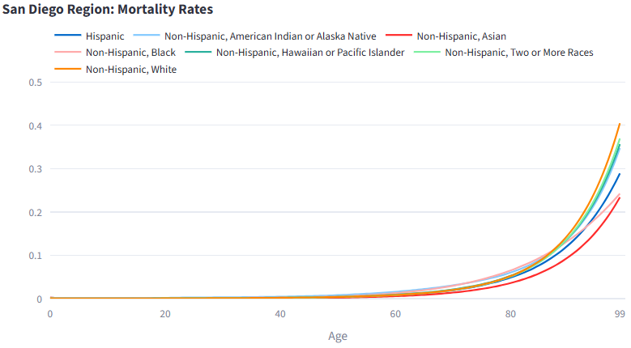
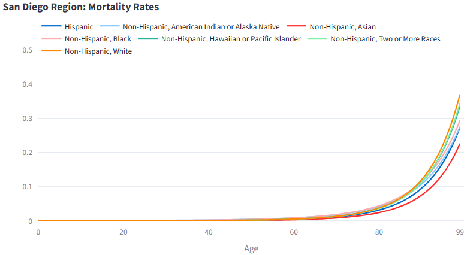
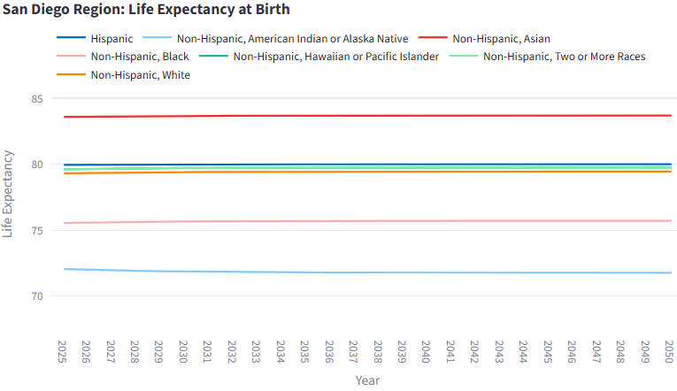
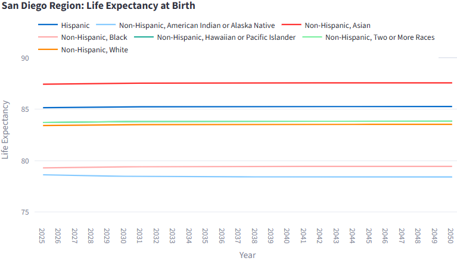

## Setup

```{python}
import pandas as pd

import report.Series16.utils as utils
```

## Overview

Mortality rates are a vital input to the Cohort Component Model, which is used to project the region’s population and households and inform the development of the Regional Forecast and Sustainable Communities Strategy. This report documents the process and rationale used to build historical mortality rate series for San Diego County (2010-2020) and to forecast life expectancies derived from those rates, forward through 2050. These forecasts are pivotal for accurately projecting the population and household dynamics of San Diego County, which in turn informs regional planning and policy decisions.

The pipeline has six stages:

1.  **Previous Methodology** - Overview of the previous mortality methodology.
2.  **Limitations of the Previous Methodology** - Explanation of why the previous methodology does not accurately represent San Diego County's demographics.
3.  **Updated Methodology** - Introduce the updated methodology used to produce historical mortality rates from CDC WONDER and UN DESA.
4.  **Constant Rates** - Depiction of what mortality rates would look like if they remained constant through the forecasted years.
5.  **Model Forecasting** - Overview of the custom Lee-Carter model and its application to forecast future mortality rates.
6.  **Forecasted Life Expectancy** - Presentation of the life expectancy forecasted by the model through 2050.

## Previous Methodology

Historically, mortality rates were calculated using two sources: Centers for Disease Control and Prevention (CDC) WONDER mortality database and Social Security Actuarial Life Tables (SSALT).

The CDC WONDER Mortality database provides county-level mortality counts stratified by age, sex, and race/ethnicity for individuals aged 84 and younger. All unavailable mortality counts for a given age/sex/race/ethnicity combination were set to 4.5, and zero counts were treated as 1 to allow for rate calculations. Each race/ethnicity group utilizes a different data source depending on the year, with some utilizing: different geography groupings (county, state, multi-state, or national), different averages (one-year, three-year, five-year), and different mortality products (1999-2020, 2018+).

For ages 85+, the SSALT is used to calculate mortality rates by age and sex, but not by race/ethnicity. For this data source, the 2019 dataset is substituted for 2020 and 2021 due to the outsized impact of COVID-19 on geriatric death rates. There was also no data published for 2012 or 2018 so those years default to the previous years of 2011 and 2017.

## Limitations of the Previous Methodology

While this CDC WONDER methodology provided a reasonable approximation of historical mortality rates, it was not specific to San Diego County, given the multiple levels of geography used in the data sources. Additionally, `Not Stated` entries were excluded completely, meaning deaths were not accounted for in the historical mortality rates. Moreover, the differing averages create inconsistent mortality trends that may not provide an accurate reflection of the true historical mortality patterns in San Diego County. Lastly, switching between different data products as a data source in the same year and comparing the resulting race/ethnicity-specific mortality rates can introduce additional inconsistencies and should not be considered directly comparable.

Similarly, this SSALT methodology results in four years that are missing or substituted (2012, 2018, 2020, and 2021), which should be accounted for when calculating mortality rates. There is also no moving average used for the SSALT data meaning it should not be compared to moving average-based mortality rates.

## Updated Methodology

To address these limitations, we build the historical time series for forecasting using the functions defined in `python/input_modules/death_rates.py`. Code has been provided in `report/Series16/utils.py` to facilitate the construction of historical mortality rates.

### Mortality Rates

`_calculate_mortality_rates` computes single-year-of-age mortality rates for a given year by delegating to the lower-level helpers in [python/input_modules/death_rates.py](../../python/input_modules/death_rates.py).

Mortality rates continue to draw on the CDC WONDER mortality database, now paired with the United Nations Department of Economic and Social Affairs (UN DESA) Life Table Survivors dataset in place of SSALT for ages 85 and older. For both data sources, mortality rates are calculated as five-year averages, meaning the reported mortality rate for a given year represents the average rate over that year and the four preceding years.

The CDC WONDER Mortality database provides county-level mortality counts stratified by age, sex, and race/ethnicity for individuals aged 84 and younger. When county-level data are unavailable, state- or national-level data are used as substitutes to ensure mortality rates can still be calculated. Because county-level population data are unavailable for 2022 onward, population estimates are supplemented using data from the SANDAG Estimates Program and age, sex, and ethnicity (ASE) distributions from the California Department of Finance (DOF). To address mortality counts that are unattributable to a specific demographic, deaths are inflated by year, geography, and sex to account for the unattributable counts. Mortality rates are then calculated using the inflated death counts and the corresponding population estimates.

For ages 85+, the UN DESA Life Table Survivors provides detailed single-year age mortality rates by sex but lacks the geographic specificity and race/ethnicity detail required. In contrast, CDC WONDER provides San Diego County mortality data by sex and race/ethnicity for the ages 85 and older group but lacks single-year age detail. A scaling method reconciles these data sources by scaling the UN DESA sex- and age-specific mortality rates such that their overall aggregated ages 85 and older mortality rate matches the corresponding San Diego County CDC WONDER mortality rate for each sex by race/ethnicity group. This approach yields geographically specific single-year age mortality rates stratified by sex and race/ethnicity for ages 85 and older.

For the historical timeline, we utilize all data from 2010 to 2020. After 2020, the CDC WONDER Mortality database expanded its race and ethnicity classifications from five categories (White; Black; Asian/Pacific Islander; American Indian/Alaska Native; and Hispanic) to seven categories (White; Black; Asian; Native Hawaiian or Other Pacific Islander; American Indian or Alaska Native; Hispanic; and Two or More Races). As we want rates for all seven race/ethnicity categories, we keep `Two or More Races` and `Native Hawaiian or Pacific Islander`, which do not exist as separate categories in the pre-2021 product. For these two categories, we use the product's all-races, non-Hispanic mortality data as a proxy, so both receive identical rates that reflect the overall non-Hispanic population rather than group-specific mortality. We considered using 2010 to 2024 and 2022 to 2024 (as 2021 data is unavailable and defaults to 2020) but ultimately decided against it. Mixing the two products would introduce inconsistencies due to the differing classification schemes and incomplete data for certain years, and using only three years of data substantially limits the model’s ability to capture long-term mortality patterns and would lead to greater volatility in the resulting forecasts. As a result, we focus on the 2010-2020 period for constructing the historical time series to ensure consistency in race and ethnicity classifications. 

Mortality rates are then smoothed within each year across ages to reduce volatility, especially those with low populations, while preserving the characteristic structure of the mortality curve (elevated infant mortality, declining young mortality, a rise starting in adolescence, and continued increase into older ages) as seen in `_smooth_rates` in [python/input_modules/death_rates.py](../../python/input_modules/death_rates.py).

```{python}
mortality_availability = range(2010, 2021)

mortality_list = []
for year in mortality_availability:
    mortality_list.append(utils._calculate_mortality_rates(year=year).assign(year=year))
mortality = pd.concat(mortality_list, ignore_index=True)
```

## Constant Rates

With this new methodology, we now have historical mortality rates for 2010 to 2020. If we were to hold the rates constant beyond 2020, the mortality rates would remain at the levels observed in 2020 and appear as follows:

**Constant Male Mortality Rates**



**Constant Female Mortality Rates**



Across both genders, mortality rates are low and similar across groups until the late 60s, after which they rise sharply with age. At the oldest ages, `White` has the highest mortality rates among the groups shown, while `Asian` has the lowest. `Native Hawaiian or Pacific Islander` and `Two or More Races` have the same rates because both use the all-races, non-Hispanic CDC WONDER data (see Updated Methodology). Female mortality rates are lower than male mortality rates across most ages for all race/ethnicity groups. It is important to keep in mind that rates for ages 85-99 are scaled and may not fully reflect the true mortality patterns for these age groups. As such, the differences in rates may be more or less exaggerated.

## Model Forecasting

Although constant rates provide a useful baseline for forecasting, they fail to account for historical mortality trends and demographic changes that may influence future mortality patterns. For forecasting mortality rates, we use a damped **Lee-Carter Model**, referred to henceforth as our custom Lee-Carter model. Our custom implementation can be found in [report/Series16/utils.py](utils.py).

### Why Lee-Carter?

The Lee-Carter model is one of the most widely used statistical frameworks for forecasting mortality rates given its forecasting success and robustness, and has become a cornerstone of demographic and actuarial analysis. Per the findings in our paper "Evaluating Mortality Forecasting Models in San Diego County", we find that the damped Lee-Carter model provides a more accurate representation of recent trends for mortality. A damping factor is applied such that the trends in mortality rates are exponentially decayed through the forecast horizon. Damping was chosen given the background research and conclusion that it produced higher accuracy under shorter fitting period conditions with long forecast horizons, avoiding naïvely carrying short-term observed trends decades into the future.

### Generate Forecast

`generate_rate_forecast` generates a forecast by applying the custom Lee-Carter model to each sex and race/ethnicity group found in the historical data.

Per the findings in our paper "Evaluating Mortality Forecasting Models in San Diego County", a damping value of 0.8 performs the best for capturing recent trends in mortality while avoiding overfitting in conjunction with our custom Lee-Carter model.

```{python}
forecasted_mortality = utils.generate_rate_forecast(
    df=mortality,
    rate_col="rate_death",
    forecast_start_year=2025,
    forecast_end_year=2050,
    phi=0.8,
    output_path="output/mortality_forecast.csv",
)
```

The resulting forecast contains predicted mortality rates for each age, sex, and race/ethnicity group for the years 2025 through 2050 and can be used in the `config.yml` file to assert rates for forecasting years. 

## Forecasted Life Expectancy at Birth

With the forecasted mortality rates, we can compute the expected life expectancy at birth for each sex and race/ethnicity group. The forecasted life expectancy at birth for each sex and race/ethnicity from 2025 to 2050 is presented below. These values are derived from the custom Lee-Carter model and reflect the expected trends based on historical data.

**Forecasted Male Life Expectancies**



**Forecasted Female Life Expectancies**



Across the life expectancy forecasts for both genders, we see the same pattern where `Asian` leads with the highest life expectancy, followed by `Hispanic`, `Two or More Races` and `Native Hawaiian or Pacific Islander`, `White`, `Black` and lastly `American Indian or Alaska Native`. `Two or More Races` and `Native Hawaiian or Pacific Islander` utilize the same data and as such, have the same life expectancy. Differences in life expectancy between groups are commonly attributed to socioeconomic factors, such as income, education, and access to healthcare, along with differences in health behaviors and chronic disease burden. As such, these forecasts should be interpreted with an understanding of the underlying social determinants of health and the limitations of the data used in the model.